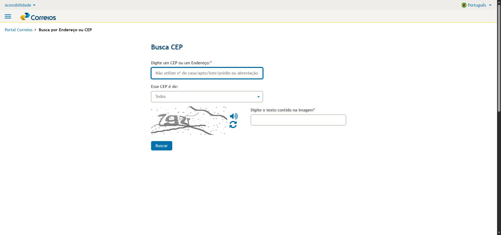
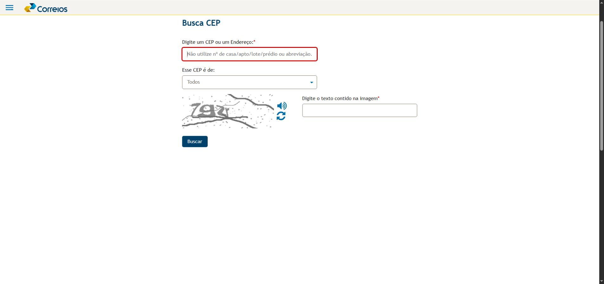
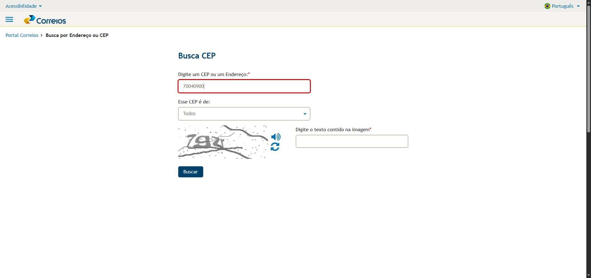
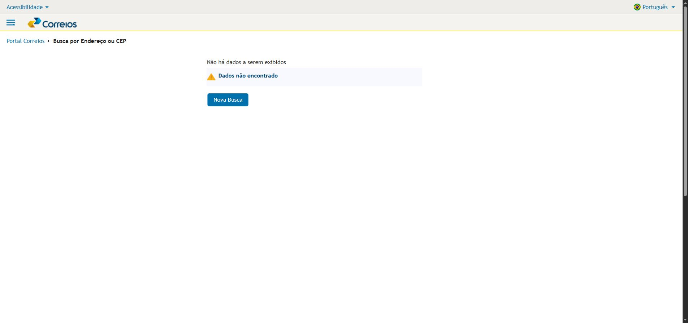

# Inspeção inicial da busca de CEP

**Rodada individual, com revisão do grupo pendente.** Este registro reúne observações da busca de CEP em 04/11/2026. As severidades são propostas. A rodada não representa uma avaliação completa dos Correios nem um teste com participantes.

<nav class="cep-overview" aria-labelledby="cep-overview-title">
  <h2 id="cep-overview-title">Achados desta inspeção</h2>
  <ul>
    <li><a href="#cep-h06-01-orientacao-disponivel-apenas-no-campo-vazio"><strong>A instrução some ao digitar</strong>H6 · Reconhecimento em vez de memorização</a></li>
    <li><a href="#cep-h03-02-alternativas-do-captcha-fora-da-sequencia-de-tab"><strong>O Tab pula os botões do CAPTCHA</strong>H3 · Controle e liberdade do usuário</a></li>
  </ul>
</nav>

## Contexto e alcance

| Item | Registro |
| --- | --- |
| Página | [Busca por Endereço ou CEP](https://buscacepinter.correios.com.br/app/endereco/index.php) |
| Tarefa | Examinar preenchimento, validação, consulta sem dados e retorno ao formulário. |
| Ambiente | Brave em Windows; área da página de 1920 × 903 pixels. |
| Métodos desta rodada | Navegação, uso de Tab e Shift+Tab, comparação visual e leitura dos atributos dos controles. |
| Entrada da consulta | `70040900`, com o filtro “Todos”. |
| Procedimento de apoio | [Checklist de Nielsen](checklist-nielsen.md) e [modelo de achado](modelo-achado.md). |

O preenchimento do CAPTCHA exigiu intervenção humana. A inspeção não avaliou o conteúdo do áudio nem a eficácia desse desafio. Também não incluiu NVDA, dispositivo móvel, medições de tempo, sucesso de uma consulta com endereços retornados ou outros fluxos dos Correios.

## Percurso observado

| Etapa | Ação | Retorno observado |
| --- | --- | --- |
| 1 | Abrir o formulário. | A orientação sobre números e abreviações aparece dentro do campo de endereço. |
| 2 | Acionar “Buscar” com os campos vazios. | A página mostra “Informe o Endereço com no mínimo 2 (dois) caracteres!” e direciona o foco ao campo de endereço. |
| 3 | Preencher o campo com `70040900`. | O texto de orientação deixa de ficar visível. |
| 4 | Acionar “Buscar” sem preencher o CAPTCHA. | A página mostra “Preencha o campo Captcha! (texto contido na imagem)” e direciona o foco ao campo correspondente. |
| 5 | Navegar do filtro “Esse CEP é de:” com Tab e retornar com Shift+Tab. | O foco passa entre o filtro e o campo de CAPTCHA, sem percorrer os controles de áudio e renovação da imagem. |
| 6 | Concluir o CAPTCHA por intervenção humana e enviar a consulta. | A tela apresenta “Não há dados a serem exibidos”, “Dados não encontrado” e o botão “Nova Busca”. |
| 7 | Acionar “Nova Busca”. | O formulário reaparece, com o campo de endereço vazio e em foco. |

O retorno da etapa 6 descreve o resultado desta tentativa. Não comprova que o CEP informado seja inválido, nem identifica uma causa para a ausência de dados.

### Evidências do percurso

*E1. Formulário antes do preenchimento. [Abrir captura](../assets/avaliacao/nielsen-busca-cep/cep-inicial.jpg).*

*E2. Validação do formulário vazio. [Abrir captura](../assets/avaliacao/nielsen-busca-cep/cep-validacao-vazio.jpg).*

*E3. Formulário após o preenchimento. [Abrir captura](../assets/avaliacao/nielsen-busca-cep/cep-campo-preenchido.jpg).*

*E4. Resultado exibido após o envio. [Abrir captura](../assets/avaliacao/nielsen-busca-cep/cep-consulta-sem-dados.jpg).*

## Achados individuais

### CEP-H06-01 - Orientação disponível apenas no campo vazio

- **Estado:** observado individualmente; revisão pendente.
- **Heurística principal:** [H6, reconhecimento em vez de memorização](../guia/heuristicas-nielsen.md#heuristica-6). Relação complementar com H10, ajuda e documentação.
- **Passos:** abrir a página, ler a orientação do campo e digitar `70040900`.
- **Observação:** a instrução “Não utilize nº de casa/apto/lote/prédio ou abreviação.” está no `placeholder`. Ao digitar, ela desaparece da tela. O rótulo permanece, mas não repete essa regra.
- **Comportamento esperado:** manter a regra perto do campo durante o preenchimento, com um exemplo que diferencie a busca por CEP da busca por endereço.
- **Evidência:** comparação entre E1 e E3. A leitura da estrutura confirmou o texto no `placeholder` e a ausência de `aria-describedby` nesse campo.
- **Severidade proposta:** **2 - pequeno**. Quem precisar reler a regra durante a digitação perde a referência visível; pode apagar a entrada para recuperá-la. O impacto é uma hipótese de inspeção, sem medição com usuários.
- **Recomendação:** exibir a orientação como texto persistente, associado ao campo. Reservar o `placeholder` para um exemplo opcional.
- **Limite:** esta observação não verifica, por si só, conformidade normativa nem a experiência com leitor de tela.

### CEP-H03-02 - Alternativas do CAPTCHA fora da sequência de Tab

- **Estado:** observado individualmente; revisão pendente.
- **Heurística principal:** [H3, controle e liberdade do usuário](../guia/heuristicas-nielsen.md#heuristica-3). Relação complementar com H7, flexibilidade de uso.
- **Passos:** posicionar o foco no campo de endereço, pressionar Tab até o filtro “Esse CEP é de:” e pressionar Tab novamente. A partir do campo do CAPTCHA, retornar com Shift+Tab.
- **Observação:** o foco vai do filtro para o campo do CAPTCHA e volta ao filtro. Os controles visíveis de áudio e renovação da imagem não entram nesse percurso. Ambos têm `tabindex="-1"` na estrutura inspecionada.
- **Comportamento esperado:** permitir o alcance das alternativas de áudio e renovação por navegação sequencial com teclado.
- **Evidência:** [captura do foco no CAPTCHA](../assets/avaliacao/nielsen-busca-cep/cep-foco-captcha.jpg) e [registro dos atributos e da sequência de foco](../assets/avaliacao/nielsen-busca-cep/observacoes.json).
- **Severidade proposta:** **3 - grande**. O percurso sequencial observado não oferece acesso a duas alternativas do desafio, o que pode dificultar a consulta de quem depende do teclado. A nota precisa de revisão e de teste com tecnologia assistiva; não foi demonstrado bloqueio de toda forma de acesso.
- **Recomendação:** usar controles nativos alcançáveis por Tab, com nomes em português, como “Ouvir desafio” e “Gerar nova imagem”, e foco visível. Verificar o acionamento por teclado e o retorno do foco após a ação.
- **Limite:** o áudio e a renovação não foram acionados nesta rodada. Não foi testado um leitor de tela ou um possível atalho alternativo.
- **Relação com a auditoria do grupo:** consulte as fichas de [operação por teclado](../referencia/criterios/operacao-plena-por-teclado-e-sem-armadilhas.md) e [CAPTCHA acessível](../referencia/criterios/captcha-acessivel-item-critico-nbr.md) para ver os resultados NBR/WCAG registrados separadamente.

## Cobertura das dez heurísticas nesta rodada

| Heurística | Alcance | Registro |
| --- | --- | --- |
| H1 | Parcial | Mensagens de validação e retorno sem dados observados; o estado durante o processamento não foi avaliado. |
| H2 | Parcial | Rótulos do formulário examinados. A compreensão dos tipos de CEP não foi verificada com participantes. |
| H3 | Problema observado | CEP-H03-02. O botão “Nova Busca” também retornou ao formulário. |
| H4 | Parcial | Formulário e retorno sem dados examinados; não houve comparação com os demais fluxos. |
| H5 | Parcial | Validações de campos vazios observadas; a matriz de formatos de entrada não foi executada. |
| H6 | Problema observado | CEP-H06-01. |
| H7 | Parcial | Trecho da navegação sequencial examinado; demais aceleradores não verificados. |
| H8 | Parcial | Hierarquia do formulário e da tela sem dados examinada apenas no desktop; sem problema adicional registrado nesse recorte. |
| H9 | Parcial | Avisos e retorno ao formulário observados; recuperação de outros erros não verificada. |
| H10 | Parcial | CEP-H06-01 como relação complementar; conteúdo externo de ajuda não avaliado. |

## Continuidade

Uma próxima rodada deve executar uma consulta que retorne endereços, verificar filtros e resultados, repetir o percurso em dispositivo móvel e conferir o CAPTCHA com teclado e leitor de tela. O grupo ainda precisa revisar as notas propostas e consolidar suas inspeções individuais.

Os dois achados deste registro não alteram os resultados da auditoria NBR/WCAG. Consulte a [síntese da avaliação](resultados.md) e o [registro do teste com participantes](../teste-usabilidade/index.md) para acompanhar as outras etapas.

## Referências

Fundamentação: [conceitos e metodologia do guia](../guia/heuristicas-nielsen.md) e [fontes do checklist de aplicação](checklist-nielsen.md#referencias).
