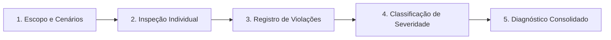

# Heurísticas de Nielsen para o Design de Interface

A **avaliação heurística** é um método de inspeção de usabilidade criado por Jakob Nielsen e Rolf Molich. Trata-se de uma abordagem ágil e de baixo custo em que especialistas analisam uma interface de usuário (UI) guiando-se por princípios predefinidos — chamados de **heurísticas** —, consolidando os resultados em um diagnóstico ou relatório técnico. 

No contexto de sistemas de informação, especialmente no **governo eletrônico (e-Gov)**, garantir a usabilidade é fundamental para a aceitação do sistema pelos cidadãos e para a oferta de serviços públicos eficientes, universais e de qualidade.

---

## 1. Apresentação dos Conceitos: As 10 Heurísticas de Nielsen

As heurísticas são princípios gerais para o design de interface de usuário que servem como "regras de ouro". A seguir, são detalhados os conceitos e exemplos práticos organizados por foco de interação:

### Feedback e Compreensão do Sistema

???+ note "1. Visibilidade do Status do Sistema"
    **Conceito:** O sistema deve sempre informar o usuário sobre o que está acontecendo no momento, fornecendo um feedback claro, compreensível e em tempo hábil.
    
    * **Aplicação e Exemplos:** Barras de progresso e carregamento, indicadores de etapas concluídas em formulários multipasso (steppers) ou mensagens de confirmação ("Salvo com sucesso", "Processando solicitação").

???+ note "2. Correspondência com o Mundo Real"
    **Conceito:** O sistema deve falar a linguagem do usuário, empregando palavras, frases e conceitos do seu dia a dia, evitando termos técnicos, siglas herméticas ou jargões de desenvolvimento. As informações devem seguir uma ordem lógica e natural.
    
    * **Aplicação e Exemplos:** Metáforas conhecidas como pastas de arquivos, ícone de lixeira para descarte, carrinho/cesta de compras e terminologias familiares ao cidadão em portais de serviços.

---

### Liberdade, Consistência e Prevenção

???+ note "3. Controle e Liberdade do Usuário"
    **Conceito:** Os usuários frequentemente realizam ações por engano ou mudam de ideia; portanto, o sistema deve fornecer "saídas de emergência" claras e visíveis para cancelar ou desfazer ações sem passar por fluxos prolongados.
    
    * **Aplicação e Exemplos:** Botões explícitos de "Cancelar", "Voltar", "Desfazer" e suporte a atalhos padrão como <kbd>Ctrl</kbd> + <kbd>Z</kbd>.

???+ note "4. Consistência e Padrões"
    **Conceito:** Os usuários não devem ter que se perguntar se palavras, situações ou ações diferentes significam a mesma coisa. O design deve manter consistência interna (no próprio sistema) e externa (seguindo convenções consolidadas da plataforma e da web).
    
    * **Aplicação e Exemplos:** Botões primários sempre com a mesma cor e posicionamento, links sublinhados ou destacados consistentemente e padrões universais de formulários e navegação.

???+ note "5. Prevenção de Erros"
    **Conceito:** Muito mais eficiente do que apresentar boas mensagens de erro é projetar uma interface que impeça o erro de acontecer em primeiro lugar. O design deve eliminar condições propensas a falhas ou solicitar confirmação antes de ações irreversíveis.
    
    * **Aplicação e Exemplos:** Desabilitar botões enquanto campos obrigatórios não forem válidos, máscaras inteligentes para CPF e CEP, sugestões preditivas e janelas de confirmação para exclusão de dados.

---

### Carga Cognitiva e Eficiência

???+ note "6. Reconhecimento em vez de Memorização"
    **Conceito:** Minimizar a carga de memória de trabalho do usuário. Elementos, ações e opções de navegação devem estar visíveis. O usuário não deve precisar lembrar de informações de uma página ao avançar para outra.
    
    * **Aplicação e Exemplos:** Menus e migalhas de pão (*breadcrumbs*) sempre visíveis, histórico de buscas recentes, listas de opções selecionáveis em vez de campos de digitação livre quando aplicável.

???+ note "7. Eficiência e Flexibilidade de Uso"
    **Conceito:** A interface deve acolher usuários iniciantes com facilidade de navegação, mas também disponibilizar aceleradores e atalhos para que usuários experientes executem tarefas recorrentes de forma ágil.
    
    * **Aplicação e Exemplos:** Atalhos de teclado, filtros avançados em consultas extensas, preenchimento automático de dados frequentes e personalização de painéis.

???+ note "8. Estética e Design Minimalista"
    **Conceito:** Os diálogos e telas não devem conter informações irrelevantes ou raramente necessárias. Cada unidade extra de informação compete com as informações essenciais e diminui sua visibilidade relativa (*menos é mais*).
    
    * **Aplicação e Exemplos:** Hierarquia visual clara, tipografia legível, espaços em branco para respiração do layout e foco no fluxo principal da tarefa sem poluição visual.

---

### Diagnóstico de Erros e Suporte

???+ note "9. Recuperação diante de Erros"
    **Conceito:** As mensagens de erro devem ser expressas em linguagem clara (sem códigos numéricos ou jargões técnicos de banco de dados), apontar com precisão onde o problema ocorreu e sugerir construtivamente uma ação para resolução.
    
    * **Aplicação e Exemplos:** Em vez de *"Erro 404"* ou *"Invalid parameter"*, exibir *"O CPF informado possui dígitos incompletos. Por favor, verifique os 11 números digitados."*

???+ note "10. Ajuda e Documentação"
    **Conceito:** Embora o ideal seja um sistema tão intuitivo que dispense explicações adicionais, pode ser necessário fornecer auxílio e documentação. Qualquer ajuda deve ser de fácil localização, focada na tarefa do usuário, listar passos concretos e não ser prolixa.
    
    * **Aplicação e Exemplos:** Centros de Ajuda, seções de Perguntas Frequentes (FAQ), *tooltips* explicativos em campos complexos e canais de contato acessíveis.

---

## 2. Como Aplicar as Heurísticas (Metodologia Prática)

A aplicação das heurísticas não é realizada diretamente pelos usuários finais, mas sim por **avaliadores (inspetores)** que percorrem o sistema sob uma perspectiva analítica e crítica. 

Para conduzir a avaliação heurística em um projeto ou na auditoria de um site, a equipe adota o seguinte fluxo estruturado em 5 etapas:

### Etapa 1: Definição do Escopo e Cenários
Antes de iniciar a navegação, os avaliadores delimitam quais partes do sistema, fluxos de uso ou tarefas críticas serão inspecionadas (por exemplo: preencher um formulário de cadastro, consultar um serviço público, rastrear uma encomenda).

### Etapa 2: Inspeção Individual
Recomenda-se que a primeira rodada seja realizada de forma **independente por cada membro da equipe**. O avaliador navega pelo site simulando a jornada do cidadão e confronta, elemento por elemento e tela por tela, o comportamento da interface com as 10 Heurísticas de Nielsen.

### Etapa 3: Identificação e Registro de Violações
Ao detectar qualquer barreira (como um botão sem rótulo compreensível, ausência de feedback de carregamento ou mensagem técnica indecifrável), o avaliador documenta o problema com:
* **Evidência:** Print, tela ou transcrição da mensagem;
* **Contexto:** Tarefa e página onde ocorreu;
* **Heurística violada:** Relação explícita com o princípio infringido (ex: *"Violação da Heurística 2 - Correspondência com o mundo real"*).

### Etapa 4: Classificação de Severidade
Para orientar a tomada de decisão da equipe e a priorização de correções, avalia-se o impacto de cada violação na experiência do usuário (UX), adotando tipicamente a escala de severidade de Nielsen:

| Nível de Severidade | Impacto no Uso | Ação Recomendada |
| :---: | :--- | :--- |
| **0 - Sem problema** | Não afeta o uso ou a compreensão | Nenhuma ação necessária |
| **1 - Cosmético** | Inconveniente estético ou detalhe visual menor | Corrigir se houver tempo disponível |
| **2 - Pequeno** | Causa leve lentidão ou dúvida pontual | Baixa prioridade de correção |
| **3 - Grande** | Dificulta fortemente a realização da tarefa | Alta prioridade de correção |
| **4 - Catastrófico** | Impede o usuário de concluir o objetivo no sistema | Correção emergencial obrigatória |

### Etapa 5: Consolidação do Diagnóstico
Os avaliadores se reúnem em sessão de alinhamento para cruzar os achados individuais, eliminar redundâncias e gerar um **relatório consolidado**. 

No contexto de sistemas governamentais (e-Gov), essa síntese evidencia problemas estruturais de fluxo, orienta o redesenho da interface e estabelece uma ponte direta com os requisitos de acessibilidade técnica (WCAG 2.2 e ABNT NBR 17225:2025).

---

## Histórico de Versões

| Versão | Data | Descrição | Autor(es) | Revisor(es) |
| :---: | :---: | :--- | :--- | :--- |
| `1.0` | 29/10/2026 | Estruturação inicial do tópico de heurísticas | Grupo 04 | Grupo 04 |
| `1.1` | 02/11/2026 | Detalhamento dos conceitos das 10 heurísticas, metodologia prática, categorias e tabela de severidade | Grupo 04 | Grupo 04 |
