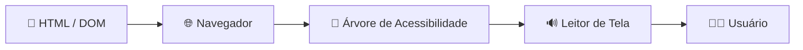

# Árvore de Acessibilidade

Owner: osakareaper

📖 [Guia de Acessibilidade](index.md) › 💡 Conceitos › Código e Semântica

<aside markdown="1">
💬

**Em uma frase:** versão simplificada da página que o navegador entrega às tecnologias assistivas — cada elemento vira um nó com **função, nome e estado**.

</aside>

## 🔄 Como a informação chega ao usuário

## 🧩 O que cada nó carrega

| Propriedade | Exemplo | Vem de |
| --- | --- | --- |
| **Função** (role) | botão, link, título nível 2 | [Semântica HTML](semantica-html.md) ou `role` |
| **Nome** | "Buscar" | [Nome Acessível](nome-acessivel.md) |
| **Estado** | expandido, marcado, desabilitado | [ARIA](aria.md) (ex: `aria-expanded`) |

## 🧪 Como ver

- **Chrome:** DevTools › Elements › Accessibility › *Enable full-page accessibility tree*.
- **Firefox:** DevTools › aba Acessibilidade.
- **Agentes de IA:** o snapshot de acessibilidade do navegador mostra o que o leitor de tela falaria — base do [Human-in-the-Loop](human-in-the-loop.md).

---

🔗 **Relacionados:** [Semântica HTML](semantica-html.md) · [ARIA](aria.md) · [Nome Acessível](nome-acessivel.md) · [Leitor de Tela](leitor-de-tela.md)
