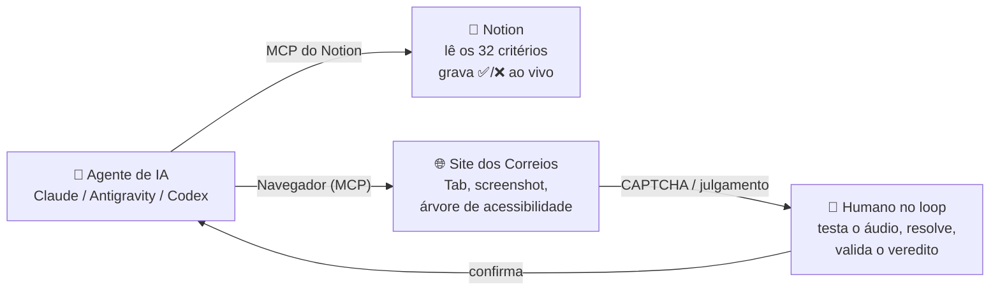

# Auditoria Assistida por IA (Human-in-the-Loop)

Owner: osakareaper

<aside markdown="1">
🤖

**Agente + Humano auditando ao vivo** — o conceito de [Human-in-the-Loop](human-in-the-loop.md) na prática. Um agente de IA conectado ao Notion e a um navegador real executa o checklist dos Correios, grava cada veredito aqui em tempo real e **pausa para pedir ajuda humana** quando a decisão exige percepção, contexto ou responsabilidade humana (como o CAPTCHA).

</aside>

<aside markdown="1">
🤖

**11 de 32 · Automática**

Código e semântica: título, idioma, landmarks, labels, nome acessível, 24×24px, contraste.

</aside>

<aside markdown="1">
🧠

**15 de 32 · IA + Visão**

Tab + screenshot + [Árvore de Acessibilidade](arvore-de-acessibilidade.md): foco visível, ordem de foco, zoom 400%, mensagens de status.

</aside>

<aside markdown="1">
🙋

**6 de 32 · Humano no Loop**

CAPTCHA, login, qualidade de texto alternativo, linguagem simples, legendas.

</aside>

<aside markdown="1">
💡

**Mensagem central do seminário:** só cerca de **1/3** do nosso checklist (11 de 32 = 34%) é verificável por automação pura, o que bate com a literatura sobre ferramentas como axe e Lighthouse. O resto exige interpretação — e é aí que o par **IA + humano** faz diferença.

</aside>

# 🏗️ Arquitetura



# 🛡️ Regras de Ouro

- 🔐 **CAPTCHA é sempre humano** ([CAPTCHA](captcha.md)). O agente identifica a barreira e explica por que ela é crítica na NBR 17225, mas **nunca tenta resolver ou contornar** o desafio. O objetivo é avaliar se ele é acessível, não burlá-lo.
- 🔑 **Login é sempre humano.** Senhas e dados pessoais são digitados por você, nunca pelo agente.
- ✍️ **Todo veredito tem evidência:** URL, seletor HTML, regra NBR/WCAG e correção sugerida.
- 🤝 **Na dúvida, pergunta.** Resultados subjetivos só são gravados depois da sua confirmação.

# ⚙️ Setup

<aside markdown="1">
✅

**Opção A — Claude (recomendada)**

1. Conecte o Notion pelos conectores do Claude (login OAuth, sem token).
2. Instale a extensão **Claude in Chrome** para o agente controlar o navegador.
3. Peça: *"Use a skill de auditoria para o fluxo 🏠 Home, só critérios 🎤 Demo."*
</aside>

<aside markdown="1">
🛠️

**Opção B — Antigravity / Codex / Claude Desktop**

Adicione dois servidores MCP: o MCP hospedado do Notion e o Playwright MCP (navegador visível).

```json
{
  "mcpServers": {
    "notion": { "command": "npx", "args": ["-y", "mcp-remote", "https://mcp.notion.com/mcp"] },
    "playwright": { "command": "npx", "args": ["-y", "@playwright/mcp@latest"] }
  }
}
```

</aside>

<aside markdown="1">
⚠️

Se usar o servidor antigo com token (`@notionhq/notion-mcp-server`), nunca mostre o token em slides ou gravações, e lembre de compartilhar a página com a integração em **••• → Connections**.

</aside>

[Skill: Auditar acessibilidade com agente + humano (NBR 17225 / WCAG 2.2)](procedimento-de-auditoria.md) — instruções completas que o agente segue (camadas, protocolo humano, formato das evidências e scripts de apoio).

# 🎤 Roteiro do Seminário (5–8 min)

| Tempo | Momento | Critérios | O que o público vê |
| --- | --- | --- | --- |
| 0:00 | ⚡ Velocidade | 5.13.1 Título/Idioma · 5.4.1 Landmarks | O agente inspeciona o código em segundos e o painel muda de cor sozinho. |
| 1:30 | 🔎 Achado no código | 5.11.3 Contraste · 5.8.3 Botões sem nome | O agente encontra o trecho HTML exato e grava ❌ com a correção sugerida. |
| 3:00 | ⌨️ Teclado ao vivo | 5.1.1 Foco visível | O navegador "anda sozinho" com Tab enquanto a IA julga o contorno de foco pelos screenshots. |
| 5:00 | 🙋 Momento humano | ⚠️ CAPTCHA no Rastreamento | O agente para, explica a barreira crítica da NBR, você testa o áudio e resolve. Veredito 🤝 Agente + Humano. |
| 7:00 | 📊 Fechamento | — | Painel abaixo: quantos critérios cada camada resolveu. |

### 🧯 Plano B e checklist pré-apresentação

- [ ]  Ensaiar a demo completa ao menos uma vez no mesmo computador e rede do seminário.
- [ ]  Gravar um vídeo do ensaio como backup (site lento, bloqueio anti-bot ou Wi-Fi ruim).
- [ ]  Voltar todos os critérios 🎤 Demo para ⏳ Pendente antes de começar (peça ao agente).
- [ ]  Deixar esta página e o navegador lado a lado na tela do projetor.
- [ ]  Fechar abas e notificações pessoais.

### 📝 O que ajustamos da proposta original

- **Notion sem token:** o MCP hospedado do Notion usa login OAuth, mais seguro que colar um token no arquivo de configuração.
- **CAPTCHA:** o humano resolve; o agente só audita. Pedir para o agente resolver seria contornar a própria barreira que estamos avaliando.
- **Camadas explícitas no banco:** cada critério agora tem "Camada de Teste", "Verificado por" e "URL Testada", o que transforma a teoria das 3 camadas em dado visível no painel.

# 📊 Painel ao Vivo

Deixe esta seção visível no projetor: os gráficos e a lista abaixo se atualizam sozinhos enquanto o agente grava os resultados.

[Sem título](visoes/visualizacao-03.md)

[Sem título](visoes/visualizacao-02.md)

[Sem título](visoes/visualizacao-01.md)
