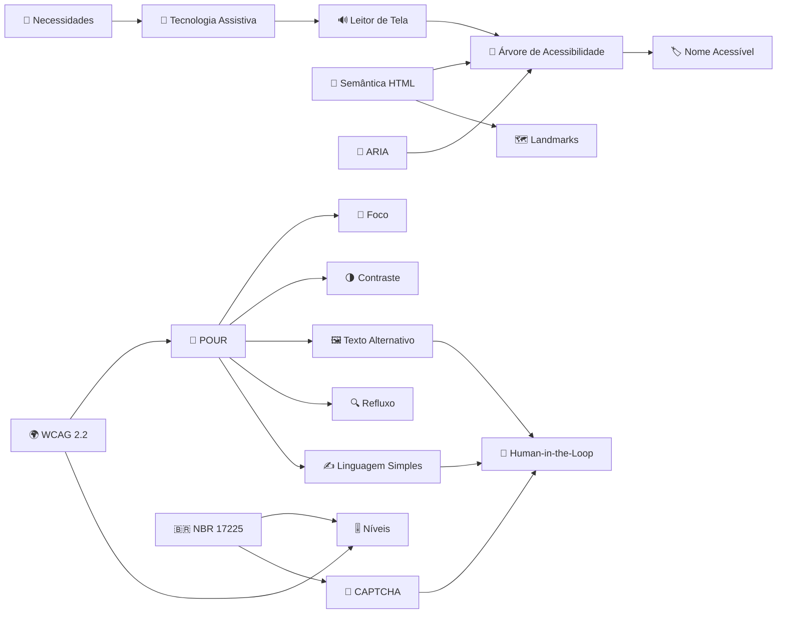

# Guia de Acessibilidade

<aside markdown="1">
👋

**Bem-vindo ao Guia de Acessibilidade.** Uma wiki que une a [NBR/ABNT](nbr-abnt.md) (ABNT NBR 17225:2025) e a [WCAG](wcag.md) (W3C WCAG 2.2) em conceitos curtos e interligados — da teoria à auditoria real.

</aside>

## 🧭 Comece por aqui

<aside markdown="1">
1️⃣

**Para quem?**

[Necessidades de Acessibilidade](necessidades-de-acessibilidade.md)

</aside>

<aside markdown="1">
2️⃣

**Os princípios**

[Princípios POUR](principios-pour.md)

</aside>

<aside markdown="1">
3️⃣

**O que é obrigatório**

[Níveis de Conformidade](niveis-de-conformidade.md)

</aside>

<aside markdown="1">
4️⃣

**Mão na massa**

[Auditoria: Site dos Correios](auditoria-site-dos-correios.md) · [Checklist Unificado](checklist-unificado.md)

</aside>

<aside markdown="1">
5️⃣

**Inspeção Heurística (Nielsen)**

[Heurísticas de Nielsen](../guia/heuristicas-nielsen.md) · [Checklist de Nielsen](../avaliacao-site/checklist-nielsen.md)

</aside>

## 📚 Normas

<aside markdown="1">
🇧🇷

[NBR/ABNT](nbr-abnt.md)

Norma brasileira: 146 itens em 16 seções por componente de interface.

</aside>

<aside markdown="1">
🌍

[WCAG](wcag.md)

Diretriz internacional: 4 princípios POUR e níveis A, AA e AAA.

</aside>

## 💡 Conceitos

**🧱 Fundamentos**

[Necessidades de Acessibilidade](necessidades-de-acessibilidade.md)
[Princípios POUR](principios-pour.md)
[Níveis de Conformidade](niveis-de-conformidade.md)
[Tecnologia Assistiva](tecnologia-assistiva.md)
[Leitor de Tela](leitor-de-tela.md)

**💻 Código e Semântica**

[Semântica HTML](semantica-html.md)
[Nome Acessível](nome-acessivel.md)
[Árvore de Acessibilidade](arvore-de-acessibilidade.md)
[ARIA](aria.md)
[Landmarks](landmarks.md)

**🎨 Interface**

[Foco do Teclado](foco-do-teclado.md)
[Contraste de Cores](contraste-de-cores.md)
[Texto Alternativo](texto-alternativo.md)
[Refluxo e Zoom](refluxo-e-zoom.md)
[Linguagem Simples](linguagem-simples.md)

**🔎 Auditoria**

[CAPTCHA](captcha.md)
[Human-in-the-Loop](human-in-the-loop.md)

## 🛠️ Prática

<aside markdown="1">
📦

[Auditoria: Site dos Correios](auditoria-site-dos-correios.md)

4 fluxos e checklist com 32 critérios NBR + WCAG.

</aside>

<aside markdown="1">
🤖

[Auditoria Assistida por IA (Human-in-the-Loop)](auditoria-assistida.md)

Agente + humano auditando ao vivo, com painel.

</aside>

<aside markdown="1">
🧰

[Kit de Ferramentas](kit-de-ferramentas.md)

[Glossário A–Z](glossario-az.md)

[Skill: Auditar acessibilidade com agente + humano (NBR 17225 / WCAG 2.2)](procedimento-de-auditoria.md)

</aside>

## 🕸️ Mapa de Conhecimento

## 📂 Todas as páginas

[NBR/ABNT](nbr-abnt.md)

[WCAG](wcag.md)

[Necessidades de Acessibilidade](necessidades-de-acessibilidade.md)

[Princípios POUR](principios-pour.md)

[Níveis de Conformidade](niveis-de-conformidade.md)

[Tecnologia Assistiva](tecnologia-assistiva.md)

[Leitor de Tela](leitor-de-tela.md)

[Semântica HTML](semantica-html.md)

[Nome Acessível](nome-acessivel.md)

[Árvore de Acessibilidade](arvore-de-acessibilidade.md)

[ARIA](aria.md)

[Landmarks](landmarks.md)

[Foco do Teclado](foco-do-teclado.md)

[Contraste de Cores](contraste-de-cores.md)

[Texto Alternativo](texto-alternativo.md)

[Refluxo e Zoom](refluxo-e-zoom.md)

[Linguagem Simples](linguagem-simples.md)

[CAPTCHA](captcha.md)

[Human-in-the-Loop](human-in-the-loop.md)

[Auditoria: Site dos Correios](auditoria-site-dos-correios.md)

[Auditoria Assistida por IA (Human-in-the-Loop)](auditoria-assistida.md)

[Kit de Ferramentas](kit-de-ferramentas.md)

[Glossário A–Z](glossario-az.md)

[Skill: Auditar acessibilidade com agente + humano (NBR 17225 / WCAG 2.2)](procedimento-de-auditoria.md)
