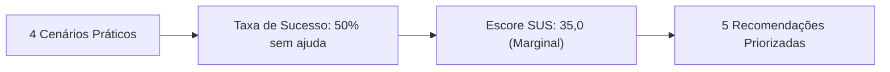

# Avaliação com Usuário: Teste de Usabilidade (Tg-03)

Documentação completa da avaliação empírica do sítio eletrônico dos **Correios**, realizada com a participação de usuário real (**P1**) conforme o método de **Rubin e Chisnell (2008)**, em conformidade com as exigências da disciplina de Interação Humano-Computador.

## [Planejamento & Roteiro](roteiro.md)

Definição dos 4 cenários práticos (Cálculo de Preço/Prazo, Busca de CEP, Agências e Rastreamento), critérios de sucesso, tempos de referência e protocolo *Think-Aloud*.

## [Participante & LGPD](participante-termo.md)

Perfil demográfico e de navegação de P1, anonimização estrita conforme a Lei Geral de Proteção de Dados e registro do Termo de Consentimento (TCLE).

## [Sessão & Gravação](sessao-gravacao.md)

Relato da condução no Teams, registro de incidentes técnicos superados, síntese da entrevista inicial e da entrevista qualitativa final.

## [Resultados & Escore SUS](resultados-sus.md)

Taxas de sucesso por tarefa (50% sem ajuda / 50% com ajuda), análise de erros e cálculo detalhado do escore SUS (**35,0** - Usabilidade Marginal/Baixa).

## [Cruzamento com o Pocket](relacao-pocket.md)

Matriz de triangulação correlacionando os problemas observados com os itens da NBR 17225, WCAG 2.2 e Heurísticas de Nielsen, além das 5 recomendações priorizadas.

## [Protótipo da Solução](prototipo.md)

Proposta de redesenho da recomendação de maior severidade (substituição do CAPTCHA visual distorcido por validação acessível).

---

## Síntese Executiva da Avaliação

* **Data da Sessão:** 10 de novembro de 2026, às 19:00.
* **Diagnóstico Geral:** A interface foi percebida pelo participante como **contraintuitiva** e sobrecarregada de estímulos visuais, com destaque negativo para as barreiras impostas pelo CAPTCHA na simulação de frete e pela desorientação na busca de agências.
