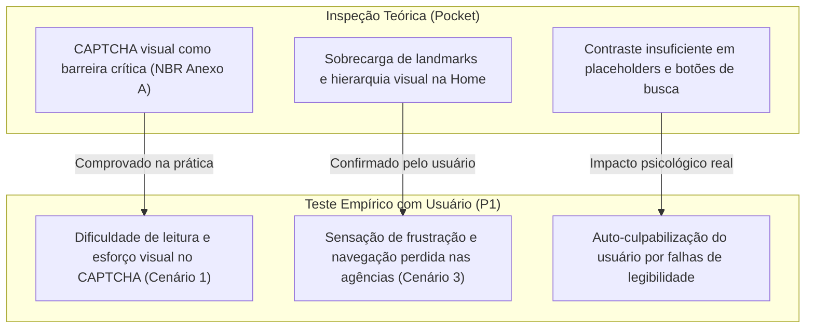

# Cruzamento: Teste de Usabilidade x Pocket de Acessibilidade

Esta seção realiza a **triangulação de métodos de IHC**, contrastando os dados empíricos observados na sessão com o usuário real (**P1**) com os critérios teóricos do **Guia/Pocket de Acessibilidade (NBR 17225 / WCAG 2.2)** e as **Heurísticas de Nielsen**.

---

## 1. Tabela Comparativa de Problemas, Evidências e Severidade

A severidade dos problemas observados no teste empírico foi graduada conforme a escala clássica de Nielsen (1994):
* `1` - Cosmético | `2` - Menor | `3` - Grave | `4` - Catastrófico.

| ID | Problema Observado no Teste com Usuário | Evidência na Sessão (Fala / Comportamento) | Severidade (Nielsen) | Relação com Item do Pocket / Norma | Relação com Heurística de Nielsen |
| :---: | :--- | :--- | :---: | :--- | :--- |
| **PB-01** | **Dificuldade de identificação visual do CAPTCHA** no fluxo de cálculo de preços e prazos. | P1 deparou-se com caracteres distorcidos de difícil leitura e relatou esforço visual para identificar o código, conseguindo contornar a barreira sozinho ao focar a visão. | **2 (Menor)** | Critério [CAPTCHA Acessível](../referencia/criterios/captcha-acessivel-item-critico-nbr.md) (Anexo NBR / WCAG 3.3.8 / 1.1.1). | **H5** (Prevenção de Erros) / **H9** (Recuperação). |
| **PB-02** | **Desorientação na busca de agências e horários** (Cenário 3). | P1 navegou erraticamente entre menus de atendimento e logística; relatou ter sido o momento de maior frustração da sessão. | **3 (Grave)** | Critério [Demarcação de Regiões / Landmarks](../referencia/criterios/demarcacao-semantica-de-regioes-landmarks.md) e [Propósito de Links](../referencia/criterios/proposito-claro-de-links.md). | **H6** (Reconhecimento em vez de memorização) / **H8** (Minimalismo). |
| **PB-03** | **Poluição visual e sobrecarga de informações na Home**. | Na entrevista final, P1 destacou a interface como contraintuitiva devido ao excesso de banners e chamadas comerciais competindo entre si. | **2 (Menor)** | Critério [Espaçamento de Texto Adaptável](../referencia/criterios/espacamento-de-texto-adaptavel.md) e boas práticas de design limpo. | **H8** (Estética e Design Minimalista). |
| **PB-04** | **Dificuldade na localização visual do campo de rastreamento**. | P1 relatou hesitação inicial ao procurar onde inserir o código de objeto, atribuindo incorretamente a dificuldade a limitações visuais próprias. | **2 (Menor)** | Critérios [Contraste Mínimo](../referencia/criterios/contraste-minimo-para-texto-4-5-1-3-1.md) e [Rótulos Visíveis](../referencia/criterios/rotulos-labels-visiveis-e-associados-aos-campos.md). | **H1** (Visibilidade do Status) / **H2** (Correspondência com o Mundo Real). |
| **PB-05** | **Duplicidade e rotulagem confusa na busca de endereços e CEP**. | P1 precisou de orientações iniciais para diferenciar a consulta rápida da Home da ferramenta detalhada de busca por logradouro. | **2 (Menor)** | Critérios [Semântica e Nome Acessível em Botões](../referencia/criterios/semantica-e-nome-acessivel-em-botoes.md) e [Linguagem Simples](../referencia/criterios/linguagem-simples-e-clareza-textual.md). | **H4** (Consistência e Padrões). |

---

## 2. Análise da Triangulação: O que o Pocket antecipou x O que só o teste revelou

1. **Problemas Antecipados pela Inspeção:** A barreira imposta pelo CAPTCHA tradicional e a sobrecarga de elementos na página inicial já constavam como riscos graves na auditoria técnica de acessibilidade. O teste empírico comprovou que até mesmo usuários jovens e sem deficiência encontram esforço visual excessivo para decifrar os caracteres distorcidos.
2. **Problemas Revelados Exclusivamente pelo Teste Real:**
    * A dificuldade no fluxo de agências (Cenário 3), em que a pessoa explorou caminhos lógicos conceituais (como *"Logística"* e *"Atendimento"*) que não correspondiam ao modelo mental adotado pela arquitetura de informação dos Correios.
    * O fenômeno de **auto-culpabilização**: o participante P1 declarou na entrevista final que sua hesitação decorria de *"suas próprias limitações visuais"*, quando a evidência técnica demonstra que os campos sofrem de contraste deficiente e falta de destaque ergonômico.

---

## 3. As 5 Recomendações Priorizadas de Redesign

Com base na severidade e na frequência dos obstáculos enfrentados pelo participante, o grupo elenca as 5 intervenções prioritárias:

1. **Recomendação 1 (Prioridade Máxima — PB-01): Substituição do CAPTCHA por Validação Invisível ou Desafio Não-Cognitivo.**  
   *Ação:* Adotar mecanismos modernos de segurança de backend (ex: reCAPTCHA v3 invisível, honeypot de formulário ou autenticação sem distorção gráfica), garantindo conformidade com o critério crítico da NBR 17225 e WCAG 3.3.8.
2. **Recomendação 2 (Prioridade Alta — PB-02): Reformulação da Ferramenta de Busca de Agências.**  
   *Ação:* Posicionar um atalho direto e unificado na página inicial para "Encontrar Agências", com busca direta por CEP/bairro e visualização clara dos horários em texto puro no primeiro nível de visualização.
3. **Recomendação 3 (Prioridade Alta — PB-04): Aumento do Contraste e Destaque do Rastreamento.**  
   *Ação:* Aumentar a área física de toque/clique e o contraste da caixa de rastreio na Home, acompanhada de botão com rótulo textual explícito ("Rastrear Objeto"), mitigando a dúvida sobre a funcionalidade do ícone de lupa.
4. **Recomendação 4 (Prioridade Média — PB-03): Limpeza Visual da Página Inicial (*Shift to Minimal*).**  
   *Ação:* Aplicar a Heurística 8 de Nielsen, agrupando links secundários em menus colapsáveis e priorizando visualmente os 3 serviços mais utilizados (Rastrear, Calcular Frete e Buscar CEP).
5. **Recomendação 5 (Prioridade Média — PB-05): Unificação da Jornada de Busca de CEP.**  
   *Ação:* Unificar o mecanismo de busca de CEP, permitindo que um único campo inteligente aceite tanto o código numérico quanto o endereço textual com autopreenchimento preditivo.

---

## Histórico de Versões

| Versão | Data | Descrição | Autor(es) | Revisor(es) |
| :---: | :---: | :--- | :--- | :--- |
| `1.0` | 29/10/2026 | Estrutura preliminar de triangulação | Grupo 04 | Grupo 04 |
| `2.0` | 10/11/2026 | Matriz de problemas e evidências reais, triangulação com o Pocket e 5 recomendações priorizadas | Grupo 04 | Grupo 04 |
| `2.1` | 10/11/2026 | Ajuste da evidência do CAPTCHA (resolução autônoma com esforço visual) e reclassificação de severidade | Grupo 04 | Grupo 04 |
